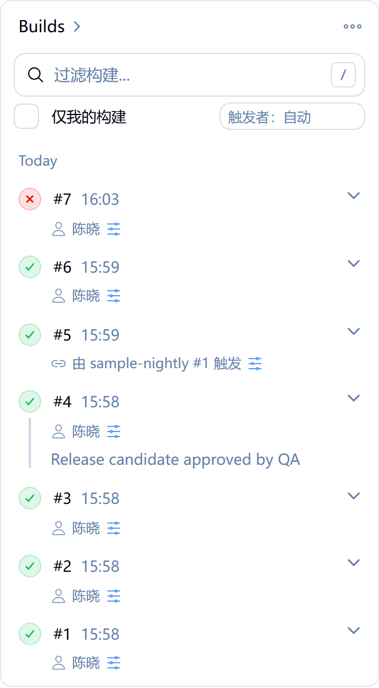
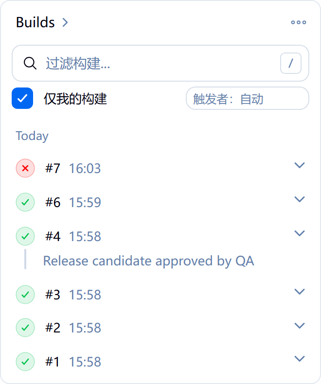
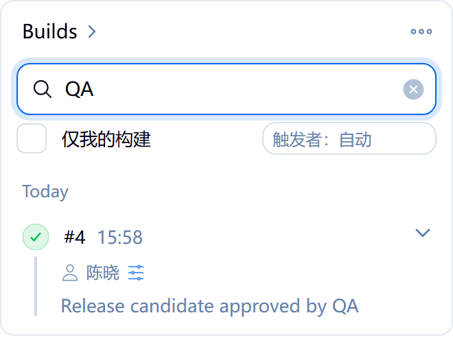

# 构建历史增强（Build History Enhancer）

[](https://github.com/Liam-Frost/Jenkins-Build-History-Enhancer-Plugin/actions/workflows/build.yml)
[](https://www.jenkins.io/)
[](LICENSE.md)

[English](README.md) · 简体中文

在每个任务页面的构建历史侧边栏里增加四项功能：

- **仅我的构建**筛选
- 覆盖**全部构建历史**的搜索，而不只是已加载的那几条
- 每次构建下方一行，显示**由谁或什么触发**
- **复用参数**的快捷入口，打开预先填好参数的构建表单

插件在原有的构建卡片上做增强，不替换它。每一行仍由 Jenkins 自己绘制，所以状态图标、徽章、进度条、取消按钮、行菜单和深色主题都和原来一样。

<p align="center">
  
</p>

## 快速开始

安装插件后打开任意任务，控件会出现在构建卡片的搜索框下方，不需要任何配置。

如果要使用复用参数功能，还需要安装 [Rebuilder](https://plugins.jenkins.io/rebuild/) 插件。

### 安装

插件进入 Jenkins 更新中心后，在 **Manage Jenkins → 插件管理 → Available plugins** 中安装即可。

在此之前，可以从 [GitHub Releases](https://github.com/Liam-Frost/Jenkins-Build-History-Enhancer-Plugin/releases) 下载 `build-history-enhancer-<版本>.hpi`，在 **Manage Jenkins → 插件管理 → Advanced settings → 部署插件** 中上传，然后按提示重启 Jenkins。

（Jenkins 2.580 的中文界面只翻译了一部分，上面的菜单名按中文界面中实际显示的写。）

## 功能

### 仅我的构建

勾选**仅我的构建**后，只保留你自己触发的构建。由定时任务、代码变更、上游任务或匿名用户触发的构建，都不算作你的构建。

未登录时这个复选框不可用。

<p align="center">
  
</p>

### 搜索

搜索框会在任务的全部构建历史中匹配：

- 构建编号
- 构建的显示名称
- 构建的描述
- 触发者的用户 ID 和全名

如果只想按触发者搜索，输入 `user:` 加上用户 ID 或名字，例如 `user:alex`。这样只会找到 Alex 触发的构建，不会找到描述里提到 Alex 的构建。

搜索和**仅我的构建**会同时生效：勾选复选框后搜索 `user:bob` 不会有结果，因为你的构建都不是 Bob 触发的。

插件不搜索构建参数的值，以免通过搜索探出参数内容。

<p align="center">
  
</p>

### 触发者

每次构建下方有一行，显示由谁或什么触发：

| 触发方式 | 显示为 |
| --- | --- |
| 用户 | 用户的全名 |
| 定时任务 | 定时触发 |
| 代码变更 | 代码变更触发 |
| 上游任务 | 由 *上游任务* #*编号* 触发 |
| 匿名用户 | 匿名触发 |
| 其他方式，例如其他插件 | 该触发方式自己的描述，例如 *Started by GitHub push* |

复选框旁边的选择框决定这一行什么时候显示，选择会保存在你的用户账号里。

- **触发者：自动**（默认）：勾选仅我的构建时隐藏，因为此时列出的都是你的构建。
- **触发者：始终显示**：总是显示。
- **触发者：不显示**：总是隐藏。

### 复用参数

安装 Rebuilder 后，带参数运行过的构建会在触发者名字旁边出现一个复用图标。点击后会打开 Rebuilder 的表单，表单里已经填好这次构建用过的参数，你可以先修改，再点 **Rebuild**。点击图标本身不会触发构建。

以下情况不显示这个图标：

- 构建运行时没有参数
- 你没有构建这个任务的权限
- Rebuilder 被设置为不显示表单、直接重新构建

## 配置

**Manage Jenkins → 系统配置 → 构建历史增强**

| 设置 | 默认值 | 作用 |
| --- | --- | --- |
| 增强构建历史侧边栏 | 开启 | 不卸载插件就能关闭它。关闭后侧边栏与原生 Jenkins 完全一致。 |
| 每页显示的构建数 | 30 | 筛选结果每页显示多少个匹配的构建（5–100）。 |
| 每次搜索最多检查的构建数 | 2000 | 一次搜索最多往前读取多少个构建（50–50000）。 |

构建历史很长的任务，搜索可能在找到匹配项之前就达到上限。这时侧边栏会提示已经检查了多少个构建，并提供继续搜索更早构建的选项。

这些设置也可以用 [Configuration as Code](https://plugins.jenkins.io/configuration-as-code/) 管理：

```yaml
unclassified:
  buildHistoryEnhancer:
    enabled: true
    pageSize: 30
    maxScan: 2000
```

## 语言

插件提供英文和简体中文，与 Jenkins 页面其余部分使用同一种语言：

- 浏览器设置为任何一种中文（中国大陆、台湾、香港等），显示简体中文
- 浏览器设置为其他语言，显示英文
- 完全不发送语言信息的客户端（例如脚本），使用服务器的语言，与 Jenkins 本身一致

## 兼容性

- Jenkins 2.580.2 或更高版本
- 自由风格项目、流水线以及其他任务类型，包括文件夹中的任务
- 浅色和深色主题

## 限制

- 排队中的构建只在第一页显示，与原生 Jenkins 一致。
- 在构建历史很长的任务中搜索，可能需要多次点击"继续"才能找到很早的构建。
- 插件依赖当前 Jenkins 版本中构建卡片的页面结构。如果将来的 Jenkins 重新设计了这个卡片，插件的控件不会出现，原生侧边栏保持原样。

## 反馈问题

缺陷和功能建议请提交到 [GitHub issues](https://github.com/Liam-Frost/Jenkins-Build-History-Enhancer-Plugin/issues)。
安全问题请报告给 Jenkins 安全团队，不要公开提交，详见 [SECURITY.md](SECURITY.md)。

## 参与开发

见 [CONTRIBUTING.md](CONTRIBUTING.md)（英文）。

## 许可证

[MIT](LICENSE.md)
